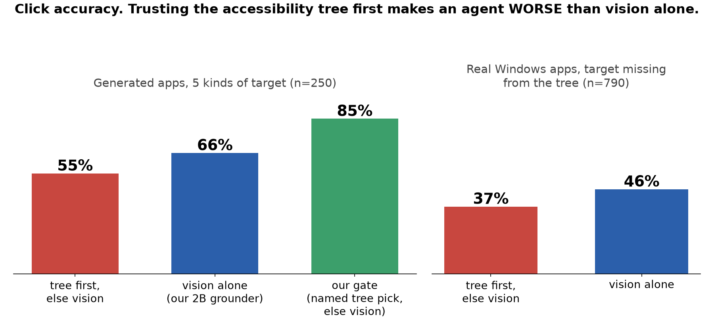

# computer-use

A computer-use agent for Windows and the web where **the LLM only decides**. Perceiving the screen,
choosing how to ground each click, the vision model that finds what the accessibility tree can't
see, the hands, the approval gate and the verifier are all ours. They're built around one measured
question: **when should an agent trust the accessibility tree, and when should it trust its eyes?**



## What we found

1. **A 2B grounder trained on free labels, on a free GPU.** Windows UI Automation already knows the
   name and box of every named element, so it labels training data for nothing. 1,572 examples from
   10 apps, LoRA on Qwen2-VL-2B, one Kaggle T4, ~8 h.

   | | zero-shot | fine-tuned | Δ [95% CI, screenshot-clustered] |
   |---|---|---|---|
   | same apps, new screenshots (n=246) | 14.2 | 64.6 | +50.4 [43.0, 57.8] |
   | **4 apps never trained on** (n=790) | 1.5 | **46.5** | +44.9 [41.1, 48.7] |
   | ScreenSpot-v2, 6-cell mean (n=1,272) | 19.2 | 62.8 | +46.1 [42.9, 49.1] |

   It gains on every platform of ScreenSpot-v2, phones included (+57.5), though it trained only on Windows.

2. **"Tree first, else vision" is worse than vision alone** once the tree is incomplete: −12.0 points
   on generated apps and −9.5 on real Windows screens with the target missing from the tree. The tree
   doesn't say "not here", it confidently returns the wrong element. Exactly:
   `fallback − vision = P(tree answers) × (tree precision − vision accuracy on those items)`.
   On generated apps that's 46.8% × (54.1 − 79.7) = −12.0.

3. **A gate that works.** An LLM reads the tree. Its pick counts only if that element **has a name**;
   otherwise our grounder decides. 85.2% vs 66.4% for vision alone on the same 250 items, chosen on
   dev and tested once, and never below vision on any of the five target conditions.

The method, every pre-registration commit and every bug that would have invalidated a result are in
[`docs/journal.md`](docs/journal.md). The paper draft is in [`docs/paper/`](docs/paper/).
`scripts/paper_numbers.py` recomputes every number and figure from the raw per-example results.

## The agent: our loop, Claude as the brain

```
perceive ──► decide ──► ground ──► act ──► verify
 tree +       the LLM    the gate   approval   plan steps need evidence;
 screenshot   (one JSON  above:     gate, did  the task's own checker
              intent)    tree/eyes  it change  decides pass, never the LLM
```

- **decide**: Claude (`claude -p`, all tools off) or any text model answers with one action, e.g.
  `{"action": "click", "target": "the floppy-disk save icon"}`. It can't point by itself: bare
  coordinates for a click are refused.
- **ground**: a named tree element is clicked through the tree. A nameless one is refused ("describe
  it"). A description goes to **our grounder**, served from a GPU (`computeruse eyes-serve`,
  `notebooks/eyes_server_kaggle.ipynb`). Verified: the live eyes return the eval's answers
  coordinate for coordinate.
- **verify**: "done" is a claim. A page or app checker reads the real state, and a wrong claim counts
  as a **false success**.

```
computeruse bench --brain groq --arm paper_blind --eyes remote --seeds 3    # A/B/C/D comparison, sandbox suite
computeruse agent "Draw boxes Brain, Router, Eyes and connect them" --site excalidraw \
    --check excalidraw --expect "Brain,Router,Eyes" --connect "Brain>Router,Router>Eyes"
```

`computeruse agent` opens a live panel. It shows every screenshot, a ring where each action landed,
which channel placed it (TREE / EYES / VISION), the router's reasons and refusals, and finally the
brain's claim beside the checker's verdict.

## Status (2026-10-18)

Done: the grounder, Tests A and B, the gates, the agent loop with router, remote eyes and checkers,
the sandbox suite. 406 tests.
Next: task-level A/B/C/D runs, the second training seed's eval, real UIA-blind targets (Test C), and
the hero demo. Gaps and the experiment backlog: [`docs/where-we-are.md`](docs/where-we-are.md),
[`docs/research/experiment-plan.md`](docs/research/experiment-plan.md).

## Setup

```
python -m venv .venv
.venv/Scripts/pip install -e .
```

The LoRA adapter (step 1179, chosen on dev) will be released with the paper. The dataset is not
released: its screenshots need a privacy audit first.
